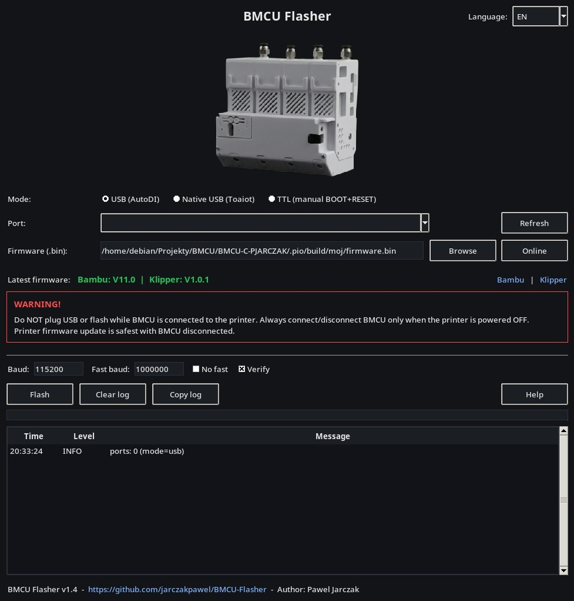

<p align="center">If BMCU Flasher or my other open-source projects are useful to you and you would like to support further development:
</p>

<p align="center">
  <a href="https://ko-fi.com/jarczakpawel">
    
  </a>
  &nbsp;
  <a href="https://revolut.me/paweqxdkx">
    
  </a>
</p>

# BMCU Flasher

Cross-platform flasher for BMCU (WCH ISP protocol).



- OS: Linux / Windows / macOS / Android
- Modes:
  - USB (BMCU with CH340 on board, AutoDI)
  - Native USB (Toaiot BMCU built-in USB, no CH340)
  - TTL (pin header / external USB-Serial, manual BOOT entry)
- Android:
  - USB (CH340 + USB OTG)
  - Native USB (Toaiot built-in USB + USB OTG)
  - TTL (external USB-Serial, manual BOOT entry)
  - Online Bambu / Klipper firmware selection
  - Local .bin file flashing
  - App language follows system language

## Download
Download prebuilt binaries from Releases.

Main builds:
- Windows x64: BMCU-Flasher-windows-x64.zip
- Windows x86: BMCU-Flasher-windows-x86.zip
- macOS Apple Silicon (arm64): BMCU-Flasher-macos-arm64.zip
- macOS Intel (x86_64): BMCU-Flasher-macos-x86_64.zip
- Linux x64: BMCU-Flasher-linux-x64.tar.gz
- Linux arm64: BMCU-Flasher-linux-arm64.tar.gz
- Android APK: BMCU-Flasher-android.apk

Legacy / experimental / community (older OS, best-effort):
- Windows legacy (older Windows): BMCU-Flasher-windows-legacy-x64.zip, BMCU-Flasher-windows-legacy-x86.zip
- macOS Catalina 10.15 (Intel): BMCU-Flasher-catalina-1.2.1.zip (community build by Doyle4, tested on Catalina)
- macOS legacy try (CI attempt): BMCU-Flasher-macos-x86_64-legacy-try.zip (may not run on Catalina)

## Run from source
Install the Python dependencies:

```bash
python -m pip install -r requirements.txt
```

Then start the GUI:

```bash
python bmcu_flasher_gui.py
```

On some Linux distributions, Tkinter may need to be installed separately (for example `python3-tk` on Debian/Ubuntu).

## Android requirements
- Android 5.0+ (API 21+) (minSdk=21)
- USB OTG + USB host mode
- CH340 supported for USB mode
- Toaiot Native USB supported through the CH32V203 USB ISP bootloader
- External USB-Serial adapters supported for TTL mode
- TTL automatically retries the full flash at 115200 baud if the fast transfer fails
- Do NOT plug USB or flash while BMCU is connected to the printer

## Firmware
Latest firmware:
- Bambu: https://github.com/jarczakpawel/BMCU-C-PJARCZAK
- Klipper: https://github.com/jarczakpawel/BMCU-Klipper

GUI has "Online" firmware selection:
- choose Bambu or Klipper
- Bambu: choose mode, AMS_AUTO (recommended) / legacy AMS_A-D, retract length, AUTOLOAD and RGB
- Klipper: the latest single firmware.bin is downloaded automatically
- both desktop and Android can also flash a local .bin file

## Drivers (CH340)
In USB mode (CH340), drivers may be required on Windows.
Linux and macOS usually work out-of-the-box.

## TTL bootloader entry
For the initial TTL bootloader entry:
- Disconnect the USB cable from the USB-Serial adapter/BMCU.
- Hold the BOOT button.
- While holding BOOT, connect the USB cable.
- Release BOOT only when the LED on the BMCU main board lights up.

If the flasher later asks you to re-enter the bootloader during the same flash:
- Keep USB connected.
- Hold BOOT.
- Tap RESET once.
- Release BOOT.

TTL is wired as RX/TX crossed, 3V3 to 3V3 and GND to GND. Do not connect 24V while flashing through the TTL adapter.

## Usage
GUI (recommended):
- Run the app
- Click "Online" to pick the exact firmware variant (mode / slot / retract / autoload / RGB)
- Click "Help" inside the app (wiring + bootloader steps)

Android:
- Install APK
- Choose USB, Native USB or TTL mode
- Choose Online or a local .bin file
- Online: choose Bambu or Klipper
- Click "Flash"

CLI (optional):
- USB (auto port by VID/PID):
```bash
python3 bmcu_flasher.py firmware.bin --mode usb
```
- TTL (manual bootloader entry, port required):
```bash
  python3 bmcu_flasher.py firmware.bin --mode ttl --port /dev/ttyUSB0
```
- Native USB (Toaiot built-in USB, no serial port):
```bash
  python3 bmcu_flasher.py firmware.bin --mode native_usb
```

## Credits
Native USB support is based on the implementation and hardware testing from the Toaiot BMCU-Flasher fork.

## License
MIT - see LICENSE.
